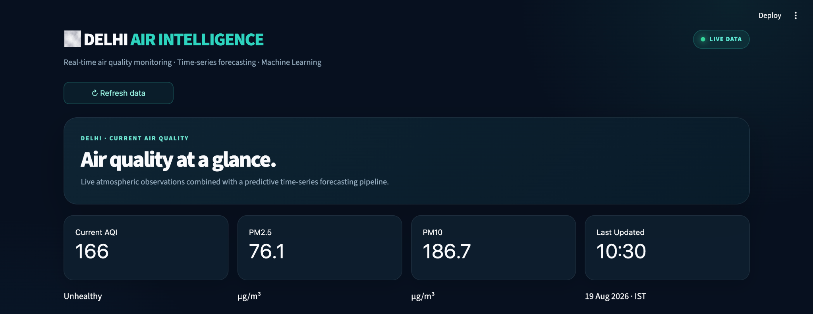
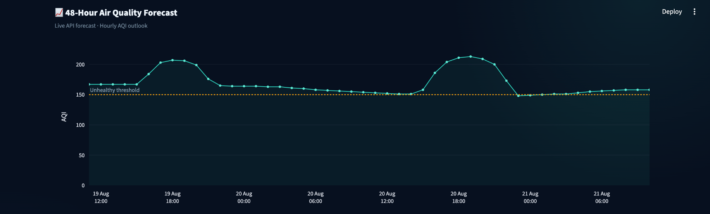
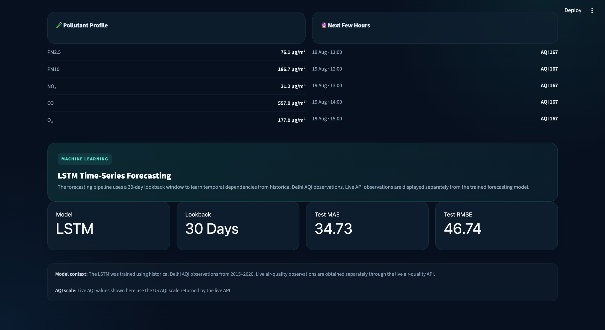
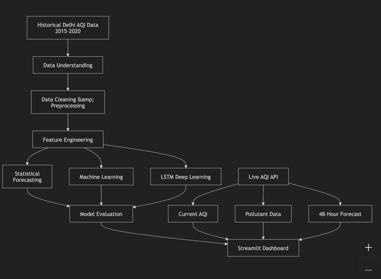

# 🌫️ Delhi Air Intelligence

### Real-Time Air Quality Monitoring · Time-Series Forecasting · Machine Learning · LSTM

An end-to-end air-quality analytics and forecasting project that combines **historical Delhi AQI data, statistical time-series analysis, machine learning, LSTM deep learning, and live air-quality API data** into an interactive Streamlit dashboard.

The project brings the complete data-science workflow together — from raw historical data and preprocessing to forecasting, model evaluation, live API integration, and an interactive web application.

## 🚀 Project Overview

Air quality is highly dynamic and changes with time, seasonality, pollutant concentration, and recurring temporal patterns.

The goal of **Delhi Air Intelligence** is to build a practical analytics system that can:

- Analyze historical Delhi air-quality data
- Understand temporal patterns in AQI
- Perform data cleaning and preprocessing
- Engineer features required for forecasting
- Apply statistical time-series forecasting techniques
- Experiment with machine-learning models
- Build an LSTM-based deep-learning forecasting model
- Evaluate forecasting performance using standard metrics
- Retrieve current air-quality observations through a live API
- Display current AQI and major pollutants
- Visualize the next 48 hours of hourly AQI forecast
- Present the forecasting pipeline through an interactive dashboard

The final result is a **production-style Streamlit application** that connects historical air-quality modeling with live air-quality monitoring.
# 🖥️ Dashboard

The project includes an interactive dashboard called **Delhi Air Intelligence**.

The dashboard is designed to answer three simple questions:

> **What is the air quality right now?**

> **What is expected to happen over the next 48 hours?**

> **How was the forecasting model developed and evaluated?**

---

## 🌫️ Current Air Quality



The dashboard provides an at-a-glance view of the current air quality, including:

- Current AQI
- PM2.5 concentration
- PM10 concentration
- Last updated time
- AQI health status
- Live-data availability

The values displayed in this section are obtained from the **live air-quality API**, rather than from the historical training dataset.

---

# 📈 48-Hour Air Quality Forecast



The dashboard retrieves an hourly AQI forecast from the live air-quality API and visualizes the expected AQI movement over the next **48 hours**.

The visualization helps identify:

- Expected pollution peaks
- AQI trends throughout the day
- Periods of elevated pollution
- Periods where AQI approaches the unhealthy threshold
- Short-term changes in air quality

The orange reference line represents the **unhealthy AQI threshold** used in the dashboard.

This section is intentionally separate from the historical LSTM model. It represents the **live API's short-term forecast**, while the LSTM section represents the forecasting model developed using historical data.

---

# 🧪 Pollutant Profile & LSTM Model



The dashboard also provides a pollutant-level view of the current air quality, including:

- PM2.5
- PM10
- NO₂
- CO
- O₃

The lower section exposes the LSTM forecasting component and its evaluation metrics.

This allows users to see both sides of the project:

**Live air-quality monitoring**

and

**Historical forecasting model development**# 🎯 Problem Statement

Air pollution is a time-dependent phenomenon.

AQI values can vary because of:

- Time of day
- Seasonal patterns
- Historical pollution behaviour
- Pollutant concentrations
- Recurring temporal patterns
- Long-term temporal dependencies

A simple snapshot of current AQI does not provide enough information to understand how air quality behaves over time.

This project therefore combines **historical time-series modeling** with **live air-quality monitoring**.

The objective is to create an end-to-end system that connects:

```text
Historical Data
      ↓
Data Understanding
      ↓
Data Cleaning & Preprocessing
      ↓
Feature Engineering
      ↓
Statistical Forecasting
      ↓
Machine Learning
      ↓
LSTM Deep Learning
      ↓
Model Evaluation
      ↓
Interactive Dashboard
      ↑
      │
Live AQI API
```

# 🧠 Project Architecture

The complete project architecture is shown below:



The architecture connects the historical forecasting pipeline with the live AQI monitoring pipeline.

The historical pipeline takes the **2015–2020 Delhi AQI data** through data preparation, statistical forecasting, machine learning, and LSTM modeling.

The live pipeline retrieves **current AQI, pollutant information, and the 48-hour API forecast** and presents them through the Streamlit dashboard.


# 📊 Data

The project uses historical Delhi air-quality observations covering the period **2015–2020** for the statistical forecasting, machine-learning, and LSTM modeling pipeline.

The historical data is used for:

- Data exploration and understanding
- Data cleaning and preprocessing
- Time-series analysis
- Feature engineering
- Statistical forecasting
- Machine-learning experiments
- LSTM model training
- Model evaluation

The project also integrates a **live air-quality API** for the Streamlit dashboard.

### Important distinction

The historical dataset and live API serve different purposes:

| Data Source | Purpose |
|---|---|
| Historical Delhi AQI data | Model development and evaluation |
| Live AQI API | Current air-quality conditions |
| Live AQI API | Short-term 48-hour AQI outlook |
| LSTM model | Historical time-series forecasting |
| Streamlit dashboard | Combines live information and model results |

The live API data is **not treated as additional historical training data for the LSTM model**.

The historical dataset is used to develop and evaluate the forecasting models, while the live API provides the real-time information displayed in the dashboard.

# 🔄 End-to-End Project Flow

The complete project follows a structured data-science workflow, starting with historical AQI data and ending with an interactive Streamlit application.

```text
Historical Delhi AQI Data (2015–2020)
                │
                ▼
        Data Understanding
                │
                ▼
     Data Cleaning & Preprocessing
                │
                ▼
        Feature Engineering
                │
        ┌───────┼────────┐
        │       │        │
        ▼       ▼        ▼
 Statistical   Machine   LSTM
 Forecasting   Learning  Deep Learning
        │       │        │
        └───────┼────────┘
                ▼
        Model Evaluation
                │
                ▼
        Streamlit Dashboard
                ▲
                │
        Live AQI API
        ┌───────┼────────┐
        │       │        │
        ▼       ▼        ▼
    Current  Pollutant  48-Hour
      AQI      Data      Forecast
```

The workflow can be divided into two major pipelines.

### 📚 Historical Modeling Pipeline

The historical Delhi AQI data from **2015–2020** is processed and used to develop multiple forecasting approaches:

```text
Historical Data
      ↓
Data Cleaning
      ↓
Feature Engineering
      ↓
Statistical Forecasting
      ↓
Machine Learning
      ↓
LSTM
      ↓
Model Evaluation
```

### 🌐 Live Monitoring Pipeline

The live AQI API provides current information and a short-term forecast:

```text
Live AQI API
      ↓
Current AQI
      ↓
Pollutant Information
      ↓
48-Hour AQI Forecast
      ↓
Streamlit Dashboard
```

### 🔗 Final Integration

Both pipelines come together in the Streamlit application:

```text
Historical Modeling ───────┐
                           │
                           ▼
                    Streamlit Dashboard
                           ▲
                           │
Live AQI API ──────────────┘
```

This architecture allows the project to combine **historical forecasting intelligence** with **real-time air-quality monitoring** while keeping the two data sources technically separate.

# 🗂️ Project Structure

The repository is organized into separate folders for data, notebooks, trained models, outputs, reusable source code, and dashboard assets.

```text
AQI-Time-Series-Forecasting/
│
├── assets/
│   ├── architecture.png
│   ├── img1.png
│   ├── img2.png
│   └── img3.png
│
├── data/
│   ├── raw/
│   │   ├── city_day.csv
│   │   ├── city_hour.csv
│   │   ├── station_day.csv
│   │   ├── station_hour.csv
│   │   └── stations.csv
│   │
│   └── processed/
│       └── delhi_aqi_timeseries.csv
│
├── models/
│   ├── final_lstm_model.keras
│   └── lstm_scaler.pkl
│
├── notebooks/
│   ├── 01_data_understanding.ipynb
│   ├── 02_data_cleaning_preprocessing.ipynb
│   ├── 03_statistical_forecasting.ipynb
│   ├── 04_machine_learning.ipynb
│   └── 05_lstm.ipynb
│
├── outputs/
│   ├── figures/
│   ├── forecasts/
│   ├── final_model_comparison.csv
│   └── final_random_forest_results.csv
│
├── src/
│   ├── __init__.py
│   ├── data_preprocessing.py
│   ├── feature_engineering.py
│   ├── forecasting.py
│   └── live_aqi.py
│
├── app.py
├── main.py
├── README.md
├── requirements.txt
└── .gitignore
```

### 📁 Folder Overview

| Folder / File | Purpose |
|---|---|
| `assets/` | Dashboard screenshots and project architecture image |
| `data/` | Raw and processed AQI datasets |
| `models/` | Trained LSTM model and scaler |
| `notebooks/` | Step-by-step analysis and modeling workflow |
| `outputs/` | Forecasts, model results, and generated figures |
| `src/` | Reusable Python modules |
| `app.py` | Main Streamlit dashboard |
| `main.py` | Project execution / modeling entry point |
| `requirements.txt` | Python dependencies |
| `.gitignore` | Files excluded from Git tracking |
| `README.md` | Project documentation |

# 🛠️ Technology Stack

The project uses a combination of data-analysis, statistical forecasting, machine-learning, deep-learning, visualization, and application-development technologies.

### 🐍 Programming

- **Python** — Primary programming language

### 📊 Data Analysis & Processing

- **Pandas** — Data manipulation and preprocessing
- **NumPy** — Numerical computation

### 📈 Data Visualization

- **Matplotlib** — Statistical and model visualizations
- **Seaborn** — Exploratory data visualization
- **Plotly** — Interactive dashboard charts and AQI forecasting visualizations

### 📉 Statistical Forecasting

- **Statsmodels** — Statistical modeling and time-series analysis
- **pmdarima** — Automated ARIMA model selection and forecasting

### 🤖 Machine Learning

- **Scikit-learn** — Machine-learning models, preprocessing, and evaluation
- **XGBoost** — Gradient-boosting based machine learning

### 🧠 Deep Learning

- **TensorFlow / Keras** — Deep-learning framework
- **LSTM** — Sequential deep-learning model for AQI time-series forecasting

### 💾 Model & File Utilities

- **Joblib** — Saving and loading preprocessing/model objects
- **OpenPyXL** — Excel file handling

### 🖥️ Application Development

- **Streamlit** — Interactive web application and dashboard

### 📓 Development & Version Control

- **Jupyter Notebook** — Exploratory analysis and model development
- **Git** — Version control
- **GitHub** — Repository hosting and project collaboration

# 📦 Installation

Follow the steps below to set up the project locally.

### 1. Clone the Repository

```bash
git clone <YOUR-GITHUB-REPOSITORY-URL>
cd AQI-Time-Series-Forecasting
```

Replace `<YOUR-GITHUB-REPOSITORY-URL>` with the actual URL of your GitHub repository.

### 2. Create a Virtual Environment

```bash
python -m venv .venv
```

### 3. Activate the Virtual Environment

#### macOS / Linux

```bash
source .venv/bin/activate
```

#### Windows

```bash
.venv\Scripts\activate
```

### 4. Install Dependencies

Install all required Python packages using the project's `requirements.txt` file:

```bash
pip install -r requirements.txt
```

The requirements file contains the libraries required for:

- Data preprocessing
- Statistical forecasting
- Machine learning
- LSTM deep learning
- Visualization
- Streamlit dashboard
- Model persistence
- Notebook-based analysis

### 5. Verify the Installation

After installation, verify that Streamlit is available:

```bash
streamlit --version
```

You can also verify the Python environment:

```bash
python --version
```

Once the dependencies are installed successfully, the dashboard can be started using the Streamlit command described in the next section.

# 💡 Key Insights

The project demonstrates several important insights from applying time-series analysis, machine learning, deep learning, and live data integration to air-quality forecasting.

### 📈 1. AQI Is a Time-Dependent Problem

Air quality observations are not independent from one another.

Previous AQI observations can provide useful information about future air-quality behaviour, making time-series forecasting techniques appropriate for this problem.

### 📊 2. Historical Data Provides Long-Term Context

The **2015–2020 historical Delhi AQI dataset** provides a foundation for understanding long-term temporal patterns and developing forecasting models.

It allows the project to move beyond a simple snapshot of current pollution levels.

### 📉 3. Statistical Models Provide a Useful Baseline

Classical time-series techniques help identify the statistical characteristics of the AQI series and provide a baseline before moving to more complex machine-learning and deep-learning approaches.

### 🤖 4. Machine Learning Can Learn from Engineered Temporal Features

Machine-learning models can use appropriately engineered historical features to identify relationships between previous observations and AQI.

This provides an alternative to purely statistical forecasting approaches.

### 🧠 5. LSTM Captures Sequential Dependencies

The LSTM model uses a **30-day lookback window** to learn from sequences of historical AQI observations.

The 30-day lookback represents the historical input sequence used for each prediction — it does **not** mean that the model was trained only on the last 30 days.

### 📏 6. Model Performance Can Be Quantified

The final LSTM model reports:

| Metric | Value |
|---|---:|
| Test MAE | **34.73** |
| Test RMSE | **46.74** |
| Lookback Window | **30 Days** |

These metrics provide a quantitative way to evaluate the model's forecasting performance on the test data.

### 🌐 7. Live Data Makes the Project More Practical

The live AQI API allows the application to display current air-quality conditions instead of relying only on historical data.

Users can see:

- Current AQI
- PM2.5
- PM10
- NO₂
- CO
- O₃
- Hourly AQI outlook

### 🔗 8. Historical Modeling and Live Monitoring Complement Each Other

The project combines two different capabilities:

```text
Historical Data
      ↓
Forecasting Models
      ↓
Model Evaluation

+

Live AQI API
      ↓
Current Conditions
      ↓
48-Hour API Forecast
```

# ⚠️ Important Interpretation Note

The project contains **two different forecasting components**, and they should not be interpreted as the same model.

### 🧠 LSTM Historical Model

The LSTM model was trained using historical Delhi AQI observations from **2015–2020**.

The model uses a **30-day lookback window**.

This means that the previous 30 observations are provided to the LSTM as an input sequence when creating forecasting examples.

It does **not** mean:

> The model was trained only on the last 30 days.

Conceptually:

```text
Historical AQI Data (2015–2020)
              ↓
      Previous 30 Observations
              ↓
             LSTM
              ↓
       Future AQI Prediction
```

The 30-day window is therefore an **input/lookback period**, not the total training period.

---

### 🌐 Live API Forecast

The **48-hour AQI forecast displayed in the Streamlit dashboard comes from the live air-quality API**.

The dashboard retrieves:

- Current AQI
- Current pollutant concentrations
- Hourly AQI forecast
- Forecast timestamps

Conceptually:

```text
Live AQI API
      ↓
Current Conditions
      +
Hourly Forecast
      ↓
Streamlit Dashboard
```

---

### 🔗 Why Are They Both in the Same Dashboard?

The two components serve different purposes:

| Component | Purpose |
|---|---|
| Historical AQI data | Model development and evaluation |
| LSTM | Historical time-series forecasting |
| 30-day lookback | Input sequence used by the LSTM |
| Live AQI API | Current air-quality monitoring |
| 48-hour API forecast | Short-term live AQI outlook |
| Streamlit | Combines the information into one application |

Therefore, the project should be understood as:

```text
Historical Data
      ↓
Statistical / ML / LSTM Modeling
      ↓
Model Evaluation

             +

Live AQI API
      ↓
Current AQI + Pollutants + 48-Hour Forecast
      ↓
Streamlit Dashboard
```

The **live API forecast should not be presented as the LSTM's 48-hour forecast**.

Similarly, the LSTM should not be described as being retrained on the latest live 2026 observations.

This distinction keeps the project's modeling methodology transparent and technically accurate.

# 🎓 What This Project Demonstrates

This project demonstrates an end-to-end understanding of a real-world **time-series forecasting and data-science workflow**, from raw historical data to an interactive application.

### 📊 Data Analysis

- Exploratory Data Analysis
- Understanding time-series data
- Identifying trends and temporal patterns
- Data quality analysis

### 🧹 Data Preparation

- Data cleaning
- Missing-value handling
- Date/time processing
- Data preprocessing
- Preparing model-ready datasets

### ⚙️ Feature Engineering

- Creating temporal features
- Working with historical observations
- Preparing sequential data for forecasting
- Building input sequences for LSTM

### 📈 Statistical Forecasting

- Time-series analysis
- Stationarity analysis
- ADF testing
- Differencing
- ACF and PACF analysis
- ARIMA-family forecasting

### 🤖 Machine Learning

- Supervised learning for forecasting
- Feature-based forecasting
- Model experimentation
- Model comparison
- Forecast evaluation

### 🧠 Deep Learning

- Neural-network based forecasting
- LSTM architecture
- Sequential data modeling
- Lookback-window construction
- Training and evaluation of an LSTM model

### 📏 Model Evaluation

The project uses forecasting metrics such as:

- Mean Absolute Error (MAE)
- Root Mean Squared Error (RMSE)

The final LSTM model reports:

```text
Test MAE  : 34.73
Test RMSE : 46.74
```

### 🌐 API Integration

The project demonstrates how a machine-learning project can be connected to external live data through an API.

The application retrieves:

- Current AQI
- PM2.5
- PM10
- NO₂
- CO
- O₃
- Hourly AQI forecast

### 🖥️ Application Development

The project moves beyond notebooks by exposing the results through an interactive **Streamlit dashboard**.

The dashboard combines:

```text
Historical Modeling
        +
Live AQI Monitoring
        +
Interactive Visualization
        ↓
Delhi Air Intelligence
```

### 🗂️ Software Project Organization

The repository also demonstrates practical project organization through:

- Modular Python source files
- Separate notebooks for different stages
- Dedicated model artifacts
- Processed data
- Generated outputs
- Dashboard assets
- Dependency management through `requirements.txt`
- Git/GitHub version control

### 🎯 Overall

The project demonstrates how to take a real-world time-series problem through the complete pipeline:

```text
Raw Data
   ↓
Data Understanding
   ↓
Cleaning & Preprocessing
   ↓
Feature Engineering
   ↓
Statistical Forecasting
   ↓
Machine Learning
   ↓
LSTM Deep Learning
   ↓
Model Evaluation
   ↓
Live API Integration
   ↓
Interactive Streamlit Application
```

Rather than focusing only on building a model, the project demonstrates the complete journey from **data preparation and modeling to evaluation, live data integration, and application development**.
# 🔮 Future Improvements

The current project provides a complete historical forecasting and live-monitoring workflow. The following improvements could make the system more powerful and production-ready.

### 🌦️ 1. Add Weather Variables

Extend the forecasting model with additional environmental variables such as:

- Temperature
- Humidity
- Wind speed
- Atmospheric pressure
- Rainfall
- Wind direction

This could allow the model to learn relationships between weather conditions and AQI.

### 🔄 2. Automated Data Collection

Build a scheduled pipeline that automatically collects and stores new AQI observations from the live API.

This would gradually create an updated historical dataset.

### 🧠 3. Automatic Model Retraining

Introduce scheduled model retraining so that the forecasting models can periodically learn from newly collected observations.

### 📈 4. Multivariate LSTM

Extend the current LSTM from a univariate AQI sequence to a multivariate model using variables such as:

```text
AQI
PM2.5
PM10
NO₂
CO
O₃
Weather Variables
```

This could provide the model with additional information when making predictions.

### 🔬 5. Experiment with Advanced Deep-Learning Models

Future experiments could compare the LSTM with:

- GRU
- Bidirectional LSTM
- Temporal CNN
- Transformer-based time-series models

### 🚨 6. AQI Alert System

Add automated alerts when AQI crosses predefined thresholds.

For example:

```text
AQI rises above threshold
        ↓
Generate Alert
        ↓
Display Warning in Dashboard
```

### 📍 7. Multiple Location Monitoring

Expand the dashboard beyond Delhi and allow users to compare AQI across multiple cities or monitoring stations.

### 📊 8. More Interactive Visualizations

Additional dashboard features could include:

- Historical AQI trends
- Pollutant trends
- Monthly comparisons
- Seasonal patterns
- Year-over-year AQI comparison
- Interactive pollutant correlations

### 📏 9. Model Monitoring

Add continuous monitoring of model performance using newly collected observations.

This could help identify when the model's accuracy begins to deteriorate.

### ☁️ 10. Public Cloud Deployment

Deploy the Streamlit application publicly so that users can access the dashboard without setting up the project locally.

# 🚀 Deployment

The Streamlit application can be deployed to a cloud platform that supports Python and Streamlit applications.

Before deployment, make sure that:

1. `requirements.txt` contains all required dependencies.
2. The application can run successfully using `streamlit run app.py`.
3. Required model artifacts are available.
4. The `assets/` folder contains the dashboard images and architecture diagram.
5. The live AQI API integration works correctly in the deployment environment.
6. API credentials, if required, are stored securely rather than hard-coded.
7. Large unnecessary files such as virtual environments and cache directories are excluded through `.gitignore`.

### Local Deployment

Run the application locally using:

```bash
streamlit run app.py
```

The application will be available at:

```text
http://localhost:8501
```

### Cloud Deployment

A cloud deployment can follow the general workflow:

```text
GitHub Repository
        ↓
Cloud Hosting Platform
        ↓
Install requirements.txt
        ↓
Run app.py
        ↓
Live Streamlit Dashboard
```

Once deployed, the application can provide access to the live AQI monitoring dashboard without requiring users to run the project locally.
# 📌 Project Highlights

```text
📊 Historical Delhi AQI Analysis
            ↓
🧹 Data Cleaning & Preprocessing
            ↓
⚙️ Feature Engineering
            ↓
📈 Statistical Time-Series Forecasting
            ↓
🤖 Machine Learning
            ↓
🧠 LSTM Deep Learning
            ↓
📏 Model Evaluation
            ↓
🌐 Live AQI API Integration
            ↓
📡 Current AQI & Pollutant Monitoring
            ↓
🔮 48-Hour API Forecast
            ↓
🖥️ Interactive Streamlit Dashboard
```

### Key Numbers

| Component | Detail |
|---|---|
| Historical Data | **2015–2020** |
| Deep Learning Model | **LSTM** |
| LSTM Lookback | **30 Days** |
| Test MAE | **34.73** |
| Test RMSE | **46.74** |
| Live Forecast | **48 Hours** |
| Dashboard | **Streamlit** |

### What Makes the Project Different?

The project does not stop at model training.

It connects multiple stages of a real-world data-science workflow:

**Historical Data**

→ **Data Preparation**

→ **Statistical Forecasting**

→ **Machine Learning**

→ **LSTM Deep Learning**

→ **Model Evaluation**

→ **Live API Integration**

→ **Interactive Dashboard**

This makes the project a complete example of taking a time-series forecasting problem from **raw data to an interactive application**.

# 👨‍💻 Author

## Sumiran

**Data Analytics · Machine Learning · Time-Series Forecasting · Data Science**


---

### 🌫️ Delhi Air Intelligence

**Historical Time-Series Forecasting + Machine Learning + LSTM + Live AQI Monitoring**

> An end-to-end data-science project connecting historical AQI modeling with a practical real-time air-quality intelligence dashboard.